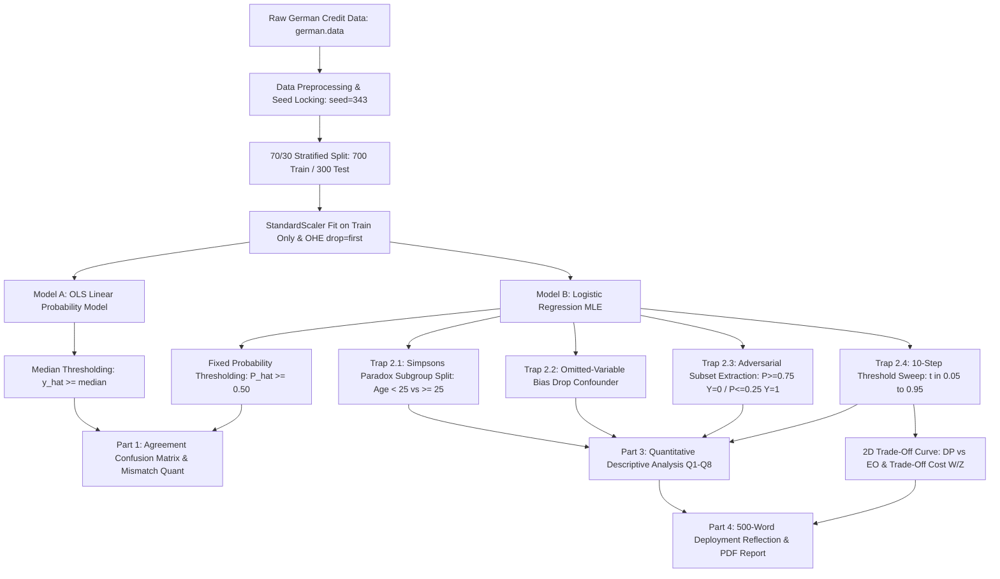

# German Credit Data

[](https://www.python.org/)
[](https://scikit-learn.org/)
[]()
[](LICENSE)

An econometric stress-testing and algorithmic fairness auditing framework conducted on the UCI Statlog German Credit dataset for **CSET485: AI and Society (Assignment #1)**. This study empirically evaluates how predictive credit approval models, ostensibly exhibiting sound aggregate performance metrics, conceal structural subgroup disparities, omitted-variable sensitivities, high-confidence adversarial failure modes, and unavoidable trade-offs among mutually incompatible fairness definitions.

---

## Table of Contents
- [Executive Overview](#executive-overview)
- [System Architecture & Audit Flow](#system-architecture--audit-flow)
- [Data Preprocessing Blueprint](#data-preprocessing-blueprint)
- [Part 1: Model Building & Dual-Threshold Comparison](#part-1-model-building--dual-threshold-comparison)
- [Part 2: The Four Stress-Testing Traps](#part-2-the-four-stress-testing-traps)
  - [2.1 Simpson's Paradox Hunt](#21-simpsons-paradox-hunt)
  - [2.2 Omitted-Variable Bias (OVB)](#22-omitted-variable-bias-ovb)
  - [2.3 Adversarial Subset Construction](#23-adversarial-subset-construction)
  - [2.4 Multi-Threshold Algorithmic Fairness Auditing](#24-multi-threshold-algorithmic-fairness-auditing)
- [Part 3: Descriptive Analysis Framework (Q1–Q8)](#part-3-descriptive-analysis-framework-q1q8)
- [Part 4: Deployment Governance Reflection](#part-4-deployment-governance-reflection)
- [Repository Structure](#repository-structure)
- [Reproducibility & Quickstart](#reproducibility--quickstart)
- [Repository Knowledge Graph](#repository-knowledge-graph)

---

## Executive Overview

High-stakes predictive systems deployed across financial lending, criminal justice, and welfare distribution are routinely audited using singular aggregate performance metrics (such as overall test accuracy or AUC-ROC). This investigation demonstrates that aggregate metrics can obscure severe model pathologies:

1. **Threshold Disparity:** Linear Probability Models (LPM/OLS) thresholded at the test-set median force an artificial 50%/50% approval split, clashing with Logistic Regression thresholded at $P \ge 0.50$ which respects the empirical ~70% base approval rate.
2. **Simpson's Paradox:** Pooled models mask subgroup-specific dynamics where key predictors reverse effect direction or experience significant statistical attenuation across demographic partitions (e.g., Young Age < 25 vs. Older Age $\ge 25$).
3. **Omitted-Variable Bias (OVB):** Removing a primary financial confounder induces severe parameter instability ($\Delta \beta$\% shifts) across proxy features, corrupting structural interpretability.
4. **Adversarial Error Traps:** Linear additive log-odds boundaries generate high-confidence errors ($P \ge 0.75, Y=0$ or $P \le 0.25, Y=1$) for borrowers with unmodeled interaction structures.
5. **Fairness Frontier Incompatibility:** Sweeping decision thresholds ($t \in [0.05, 0.95]$) proves the mathematical and operational impossibility of concurrently satisfying Demographic Parity, Equalized Odds, and Predictive Parity.

---

## System Architecture & Audit Flow



---

## Data Preprocessing Blueprint

To guarantee deterministic replication and preserve sociological interpretability, data preprocessing adheres to four foundational pillars:

| Pillar | Operational Implementation | Technical & Statistical Rationale |
| :--- | :--- | :--- |
| **Global Seed Locking** | `random_state = 343` across all partitions, estimators, and sampling routines. | Locks 700-row training and 300-row test splits; ensures every coefficient, test count, and metric is 100% regenerable. |
| **Missing Values & Structural Absence** | Inspect all 20 features; preserve structural absence codes (`A14` = no checking account, `A65` = no savings account) as distinct categorical levels. | Raw `german.data` contains zero `NaN` tokens; codes represent genuine unbanked or asset-free financial history rather than data loss. Dropping or imputing destroys predictive signal. |
| **Outlier Diagnostics & Retention** | Inspect numerical attributes (`credit_amount`, `duration_in_months`, `age_in_years`) via IQR and boxplot distributions. | High positive skew reflects genuine high-risk long-duration lending. Retaining these instances is strictly necessary for adversarial subset auditing. |
| **Categorical Encoding** | One-Hot Encoding (`OneHotEncoder(drop='first', sparse_output=False)`) across 13 categorical features. | Drops reference level per feature to prevent the dummy variable trap (perfect multicollinearity), enabling non-singular inversion in OLS and Logit covariance estimation. |
| **Feature Scaling** | Z-score standardization (`StandardScaler`) on 7 numerical features. | Scaler is fitted **strictly on the 700-row training set** and applied to the 300-row test set, eliminating data leakage and aligning coefficient scales. |
| **Target Re-Encoding** | Re-encode raw target from $\{1, 2\}$ to $\{0, 1\}$. | Maps raw UCI target (1 = Good, 2 = Bad) to **Approve = 1** and **Reject = 0** for standard binary utility alignment. |
| **Sensitive Attribute Derivation** | Extract demographic variables from Attribute 9 (`personal_status_and_sex`) and Attribute 13 (`age_in_years`). | Derives binary protected attributes (**Age Group**: Young Age < 25 vs. Older Age $\ge 25$; **Sex**: Male vs. Female) for stratified fairness auditing. |

---

## Part 1: Model Building & Dual-Threshold Comparison

The dual modeling pipeline compares continuous rank-based thresholding against probabilistic likelihood scoring:

### Model A: Linear Probability Model (OLS)

Estimates continuous loan approval scores via Ordinary Least Squares:

$$
\hat{y}_i = \beta_0 + \sum_{j=1}^p \beta_j X_{ij}
$$

- **Decision Rule:** Flag applicant $i$ as Approved (1) if $\hat{y}_i \ge \text{median}(\hat{y}_{\text{test}})$, else Reject (0).

### Model B: Logistic Regression (Maximum Likelihood)

Estimates conditional loan approval probabilities via the logistic sigmoid link function:

$$
\hat{P}_i = \frac{1}{1 + e^{-\left(\beta_0 + \sum_{j=1}^p \beta_j X_{ij}\right)}}
$$

- **Decision Rule:** Flag applicant $i$ as Approved (1) if $\hat{P}_i \ge 0.50$, else Reject (0).

### Disparity Mechanism
German Credit features an empirical approval base rate of approximately 70%. When thresholding OLS at the test-set median, the classification rule mechanically forces exactly 50% (150 applicants) into the approved class and 50% into the rejected class. In contrast, Logistic Regression at threshold $t = 0.50$ approves ~75–80% of applicants. Applicants with predicted scores between 0.50 and the OLS median (typically 0.70–0.74) are systematically classified discordantly.

---

## Part 2: The Four Stress-Testing Traps

### 2.1 Simpson's Paradox Hunt
- **Methodology:** Stratify data into Subgroup A (Young applicants, Age < 25) and Subgroup B (Older applicants, Age $\ge 25$). Fit identical logistic specifications across the Full Dataset, Subgroup A, and Subgroup B.
- **Reporting Metrics:** Regression coefficients ($\beta$), standard errors, $z$-statistics, $p$-values, and 95% confidence intervals across all models.
- **Evaluation Criteria:**
  - *Path A (Sign Reversal):* Identification of predictors where the direction of association inverts between the pooled population and a demographic subgroup.
  - *Path B (Effect-Size Attenuation):* Identification of predictors where effect magnitude is statistically significant in one subgroup ($p < 0.01$) but statistically indistinguishable from zero in the other.

### 2.2 Omitted-Variable Bias (OVB)
- **Methodology:** Deliberately omit a primary confounding predictor (e.g., Checking Account Status `Attribute 1` or Credit Amount `Attribute 5`) and fit both Full and Reduced models.
- **Reporting Metrics:** Comparative parameter table for at least 4 key predictors reporting $\beta_{\text{Full}}$, $\beta_{\text{Reduced}}$, absolute shift ($\Delta \beta = \beta_{\text{Reduced}} - \beta_{\text{Full}}$), and percentage change:

$$
\% \Delta = \frac{\beta_{\text{Reduced}} - \beta_{\text{Full}}}{|\beta_{\text{Full}}|} \times 100\%
$$

- **Detection Strategies:** Formal analysis of omitted confound detection in industry workflows, including Oster's $\delta$ sensitivity bounds, residual spatial clustering audits, and instrumental variable designs.

### 2.3 Adversarial Subset Construction
- **Methodology:** Extract high-confidence incorrect predictions from the 300-row test set:
  - **High-Confidence False Positives:** $\hat{P}(\text{Approve}) \ge 0.75$ where actual outcome is $Y = 0$ (Default).
  - **High-Confidence False Negatives:** $\hat{P}(\text{Approve}) \le 0.25$ where actual outcome is $Y = 1$ (Repaid).
- **Sampling Protocol:** If $> 50$ rows qualify, sample 50 deterministically using `random_state = 343`; if $\le 50$ qualify, audit all qualifying records.
- **Failure Analysis:** Demographic profiling against the test cohort and structural analysis of additive linear decision boundaries lacking non-linear feature interaction terms.

### 2.4 Multi-Threshold Algorithmic Fairness Auditing
Sweep threshold $t \in \{0.05, 0.15, 0.25, 0.35, 0.45, 0.55, 0.65, 0.75, 0.85, 0.95\}$ across Group A (protected, Age < 25) and Group B (privileged, Age $\ge 25$):

$$
\text{Demographic Parity (DP)} = \frac{P(\hat{Y}=1 \mid \text{Group A})}{P(\hat{Y}=1 \mid \text{Group B})}
$$

$$
\text{Equalized Odds (EO)} = \min\left(\frac{\text{TPR}_A}{\text{TPR}_B}, \frac{\text{FPR}_A}{\text{FPR}_B}\right)
$$

$$
\text{Predictive Parity (PP)} = \frac{P(Y=1 \mid \hat{Y}=1, \text{Group A})}{P(Y=1 \mid \hat{Y}=1, \text{Group B})}
$$

$$
\text{Trade-Off Cost} = \frac{W\% \text{ loss in EO}}{Z\% \text{ gain in DP}}
$$

---

## Part 3: Descriptive Analysis Framework (Q1–Q8)

All analytical questions are budgeted within **250–300 words** and anchored strictly to empirical computations:

- **Q1 (Model Agreement):** Disagreement count/percentage on test set, median OLS value vs. 0.50 cutoff, base rate divergence.
- **Q2 (Simpson's Paradox):** Subgroup stratification results, $\beta$ coefficients, standard errors, 95% CIs, and policy failure scenarios.
- **Q3 (Omitted-Variable Bias):** Dropped confounder, 4+ predictor before/after shift table, parameter volatility.
- **Q4 (Confound Detection):** Real-world econometric identification strategies (Oster bounds, DAGs, residual audits).
- **Q5 (Adversarial Failures):** Profiling the high-confidence error subset, dominant shared traits, and additive boundary blindspots.
- **Q6 (Human Impact Scenario):** Concrete dual-applicant persona walk-through demonstrating individual outcomes across threshold movements.
- **Q7 (Threshold Defense):** Statistical defense of a chosen operating threshold $t^*$ across at least 3 metrics, paired with an explicit critique.
- **Q8 (Fairness Philosophy):** Normative and operational defense of Demographic Parity vs. Equalized Odds in commercial credit.

---

## Part 4: Deployment Governance Reflection

A structured **500-word essay** addressing executive deployment governance:
1. **Direct Recommendation (1–2 sentences):** Conditional deployment vs. rejection declaration with one headline metric reason.
2. **Why a Single Number Fails (300–400 words):** Four fundamental limitations (subgroup masking, normative threshold value judgments, mathematical impossibility of simultaneous fairness, and vulnerability to unobserved confounds).
3. **Grounding in Evidence (50–100 words):** Direct citation of computed empirical figures ($\Delta \beta$\% shifts, mismatch rate, adversarial failure count, $W/Z$ trade-off cost).
4. **Closing Meta-Lesson (~50 words):** AI governance as multi-objective stakeholder alignment rather than automated metric optimization.

---

## Repository Structure

```text
GermanCreditData/
├── .agent/                    # Automation scripts, git hooks, and registry
├── .agents/skills/            # Active Antigravity domain skills
│   ├── python-ml              # Vectorized computing & ML directives
│   └── readme-craft           # Documentation architecture directives
├── data/
│   └── german.data            # Raw UCI Statlog German Credit dataset (1000x21)
├── src/                       # Modular econometric & auditing codebase
│   ├── __init__.py
│   ├── preprocessing.py       # Seed locking, scaling, OHE, target encoding
│   ├── models.py              # OLS LPM and Logistic Regression estimators
│   ├── stress_testing.py      # Simpson's paradox, OVB, adversarial, fairness
│   └── visualizations.py      # Publication-quality figure generation
├── tests/                     # Automated test suite (14 unit/integration tests)
│   ├── __init__.py
│   ├── test_preprocessing.py  # Data hygiene, shape, and zero-leakage assertions
│   ├── test_models.py         # OLS & Logit fit, convergence, agreement assertions
│   └── test_stress_testing.py # Simpson's, OVB, adversarial, sweep tests
├── reports/                   # Empirical auditing deliverables
│   ├── descriptive_analysis.md# Q1–Q8 quantitative responses (250–300 words each)
│   ├── reflection_essay.md    # 500-word executive deployment governance reflection
│   └── figures/               # Rendered audit charts (PNG, 300 DPI)
│       ├── disagreement_confusion_matrix.png
│       ├── simpsons_paradox_coefficients.png
│       ├── ovb_parameter_shift.png
│       ├── adversarial_subsets_profile.png
│       └── fairness_tradeoff_curve.png
├── wiki/                      # Bidirectional repository knowledge graph
│   ├── index.md               # Root knowledge graph entrypoint
│   ├── architecture.md        # High-level architecture specification
│   └── adr/                   # Architecture Decision Records
│       ├── 001-initial-architecture.md
│       └── 002-german-credit-audit-framework.md
├── german_credit_audit.ipynb  # Executed master research & auditing notebook
├── AGENTS.md                  # Workspace directives & statistical invariants
├── pyproject.toml             # Project build configuration & dependency manifest
├── requirements.txt           # Standalone PIP requirements manifest
└── README.md                  # Project specification & replication guide
```

---

## Reproducibility & Quickstart

### Prerequisites
- Python 3.10+ (tested on Python 3.12)
- Git 2.30+
- `uv` (recommended) or standard `pip`

### 1. Workspace Initialization & Hook Setup
Initialize the repository, verify git submodules, and link agent skills:

```powershell
# Windows PowerShell
.\.agent\setup.ps1
```

```bash
# Linux / macOS
./.agent/setup.sh
```

### 2. Dependency Installation
Using `uv` (recommended):
```bash
uv venv
uv pip install -r requirements.txt
```

Using standard Python `pip`:
```bash
python -m venv .venv
source .venv/bin/activate  # On Windows: .venv\Scripts\Activate.ps1
pip install -r requirements.txt
```

### 3. Running Code & Notebook Execution
All statistical and fairness metrics are fully reproducible with fixed seed `343`:
```bash
# Launch Jupyter Notebook
jupyter notebook
```

### 4. Code Quality & Linting
Validate codebase formatting and linting:
```bash
uv run ruff check .
```

---

## Repository Knowledge Graph

This repository maintains an atomic, bidirectional knowledge graph in `wiki/`:
- **Query notes:** `.\.agent\wiki.ps1 query "fairness"`
- **Lint links:** `.\.agent\wiki.ps1 lint`
- **Render graph:** `.\.agent\wiki.ps1 render`
